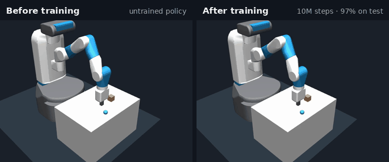

# Fetch Push PPO

Train a simulated Fetch robot arm to push a block onto a target, from scratch, with PPO on a GPU.



| | Untrained | Trained (included in `pretrained/`) |
|---|---:|---:|
| Success on 100 unseen test layouts | 10%* | **97%** (95% CI 91.5–99.0%) | 
| Mean final block-to-target distance | 15.2 cm | **1.97 cm** |
| Training time | | ~40 min on a laptop CPU (i9-13900HX, 10M steps) GPU (RTX 4070ti 8gb) |

<sub>*Untrained success is measured on the 20 validation layouts. Some starting layouts already have the block within 5 cm of the target.</sub>

- **Task:** [`FetchPushDense-v4`](https://robotics.farama.org/main/envs/fetch/push/) from Gymnasium Robotics, in the MuJoCo physics simulator. An episode lasts 50 steps and succeeds if the block ends within 5 cm of a randomly placed target.
- **What the policy sees:** 28 numbers (gripper, block and target positions and velocities). It does not use camera images.
- **What it controls:** gripper movement in x, y and z. MuJoCo handles the joint control, and the finger command is held at zero.
- **Algorithm:** PPO with a tanh-squashed Gaussian policy, built on [Tensor Optix](https://pypi.org/project/tensor-optix/) and TensorFlow. The actor and critic are each two 64-unit layers, about 6k parameters apiece.

This is a simulation result. It makes no claim about physical robots.

## The one thing that matters: the reward

With the environment's standard reward, PPO learns nothing here. The standard reward is just the negative block-to-target distance. That only changes once the block moves, and the block only moves once the arm has found it. Reaching towards the block earns nothing, so there is no signal to learn from.

The fix is one extra training-only term that rewards keeping the gripper close to the block (the same idea as Gymnasium's [Pusher](https://gymnasium.farama.org/environments/mujoco/pusher/) task):

```
training_reward = native_reward − 0.5 × ‖gripper − block‖     (metres)
```

| Run | Reward | Steps | Final test success |
|---|---|---:|---:|
| Baseline | standard (`--approach-weight 0`) | 5.0M | 9% (never beat the untrained policy) |
| This repo's default | shaped (`--approach-weight 0.5`) | 10.0M | **97%** |

Things to know about shaping:
- **It changes the objective.** It is not potential-based shaping, so there is no guarantee it preserves the optimal policy of the original task. All evaluation therefore uses the original, unshaped task.
- **The arm reaches before it pushes.** For roughly the first 1.2M steps, success stays at the baseline while the gripper learns to reach the block. Pushing appears at around 1.4M steps. Don't stop early.
- **Validation is noisy.** It is only 20 layouts, so success can swing by 20+ points between checkpoints. At 5M steps this run was at 75%. It reached 90–100% from about 6.3M steps onwards.

## Quick start

Requires **Linux or WSL2** (the simulator workers use `fork`) and **Python 3.12**.

```bash
python3.12 -m venv .venv && source .venv/bin/activate
pip install -r requirements.txt
```

`tensor-optix` also installs PyTorch, so the first install is large.

Set these before running anything, so the 16 simulator workers don't fight over CPU threads:

```bash
export OPENBLAS_NUM_THREADS=1 OMP_NUM_THREADS=1
```

**1. Check the install** (runs 4 correctness tests in a few seconds):

```bash
python test_training.py
```

**2. Evaluate the included trained policy.** It should print `"success_rate": 0.97` on the 100 test layouts:

```bash
python evaluate.py pretrained/checkpoints/010000384 --split final --output my-eval.json
```

**3. Train your own:**

```bash
python train.py                                   # writes to runs/fetch-push/
```

The defaults reproduce the 97% run: seed 43, approach weight 0.5, 5M steps with an automatic extension to 10M. Progress prints as it goes:

```
TRAIN steps=1,638,400 reward100=-9.43 kl=0.0133 elapsed=428s
VALIDATION steps=1,638,400 success=15% error=12.68cm
...
EXTENDING to 10,000,384 steps
```

When training finishes, the best checkpoint is evaluated once on the test layouts and the result is written to `runs/fetch-push/evaluation.json`.

To try a short smoke run first (about 30 seconds):

```bash
python train.py --smoke --steps 20480 --checkpoint-every 10 --output runs/smoke
```

## Using the trained policy in your own code

```python
from train import RobotAgent, configure
from runtime import make_env

configure()
agent = RobotAgent()
agent.load_weights('pretrained/checkpoints/010000384')

env = make_env()                      # make_env(render_mode='human') opens a viewer if you have a display
obs, _ = env.reset(seed=0)
while True:
    action = agent.predict(agent.obs_stats.normalize(obs[None]))[0][0]
    obs, reward, terminated, truncated, info = env.step(action)
    if terminated or truncated:
        break
print('success:', info['is_success'])
```

`predict` without `stochastic=True` returns the deterministic (mean) action, which is what all evaluation uses.

## Training options

| Flag | Default | Meaning |
|---|---|---|
| `--output` | `runs/fetch-push` | Run directory. Must be new unless you use `--resume`. |
| `--approach-weight` | `0.5` | Weight of the reach-the-block term. `0` = standard reward. |
| `--seed` | `43` | Training seed |
| `--steps` | `5001216` | Initial budget. Must be a multiple of 2048. |
| `--extend-to` | `10000384` | Extend to this many steps, but only if validation improved in the last 1M steps |
| `--envs` | `16` | Parallel simulator workers. Must divide 2048 (use 8 on smaller machines). |
| `--checkpoint-every` | `100` | Updates between checkpoints and validation (100 × 2048 ≈ 205k steps) |
| `--final-seed-base` | `400000` | First of the 100 test seeds |
| `--device` | `cpu` | `gpu` is supported, but the networks are tiny and CPU is what was tested |
| `--resume` | | Checkpoint folder to continue from. Use the same `--output`. |
| `--smoke` | | Quick check: the final evaluation uses only 2 layouts, and the run never extends |

To reproduce the failing baseline:

```bash
python train.py --approach-weight 0 --seed 42 --final-seed-base 200000 --output runs/baseline
```

## How it is evaluated

The protocol is set up so the headline number can't be tuned on the test set:

- **Validation:** 20 fixed layouts (seeds 100000–100019). Every checkpoint is scored on these. The best one is chosen by final-step success, then by mean distance.
- **Test:** 100 separate layouts (seeds 400000–400099), used **once**, after the checkpoint has been chosen. The run reports success with a Wilson 95% interval and mean final distance, and saves every individual trial.
- **Baselines:** the untrained policy and uniformly random actions are scored on the validation layouts at the start.
- Success is checked at the **final** step of the episode, not "touched the target at some point".

## What a run writes

| File | Contents |
|---|---|
| `config.json` | Every setting plus exact library versions |
| `training.jsonl` | One line per PPO update: losses, KL, clip fraction, explained variance, learning rate |
| `episodes.jsonl` | Every training episode: shaped and native return, gripper-to-block distance, block movement |
| `validation.jsonl` | Score at each checkpoint (the learning curve) |
| `random-baseline.json` | Random-action baseline |
| `best.json` | The selected checkpoint and its validation score |
| `checkpoints/NNNNNNNNN/` | Actor, critic, optimiser state, normaliser and RNG state. Runs can be resumed, though not bit-for-bit |
| `model.keras`, `critic.keras`, `normalization.json` | The selected policy, exported |
| `evaluation.json` | The one-time test result, including all 100 trials |
| `extension.json` | Written only if the run extended past `--steps` |
| `optix-internal/` | Tensor Optix's own snapshots. Not used for selection. |

## Hyperparameters

| | |
|---|---|
| Rollout | 16 envs × 128 steps = 2,048 transitions per update |
| Optimiser | Adam, learning rate 3e-4 decaying linearly to 3e-5 over 10M steps |
| PPO | clip 0.2, 10 epochs, minibatch 64, stops early when rollout KL > 0.02 |
| Returns | γ 0.99, GAE λ 0.95; time-limit truncations bootstrap from the final state |
| Loss | policy + 0.5 × value − 0.001 × entropy, gradient norm clipped at 0.5 |
| Normalisation | running observation mean/std and return-based reward scaling, both clipped to ±10, fitted on training data only |
| Networks | separate actor/critic, 2 × 64 tanh layers, orthogonal init; actor outputs mean and log-std (clipped to [−5, 2]) |

## Included trained policy

`pretrained/` holds the 10,000,384-step checkpoint from the shaped run, plus its `config.json` and `evaluation.json` (all 100 test trials).

Validation learning curve for that run (20 layouts each):

| Steps | 0 | 1.2M | 2.9M | 4.1M | 5.0M | 6.8M | 10.0M |
|---|---:|---:|---:|---:|---:|---:|---:|
| Success | 10% | 10% | 35% | 70% | 75% | 100% | 100% |
| Mean error | 15.2 cm | 14.0 cm | 8.7 cm | 4.5 cm | 3.5 cm | 1.9 cm | 1.4 cm |

## Troubleshooting

- **MuJoCo version.** Keep `mujoco==3.3.7`. MuJoCo 3.14.0 failed during robot initialisation with Gymnasium Robotics 1.4.2.
- **The Adroit warning on import** ("AdroitHand… reward functions were updated") comes from Gymnasium Robotics and is harmless. This repo doesn't use those environments.
- **Windows or macOS.** The vectorised environments use the `fork` start method, so run on Linux or WSL2.
- **Slow training.** Check that `OPENBLAS_NUM_THREADS=1 OMP_NUM_THREADS=1` are set, and lower `--envs` if you have fewer than about 16 cores.

## Files

```
train.py           PPO agent, rollout collection, checkpointing, validation/selection, final test
runtime.py         Environment wrappers: flat observations, 3-D actions, approach reward
evaluate.py        Score any saved checkpoint on the validation or test layouts
test_training.py   Correctness tests: GAE boundaries, env contract, shaping, likelihoods, save/load
pretrained/        Trained checkpoint, config and test results
```

## License

MIT. See [LICENSE](LICENSE).
